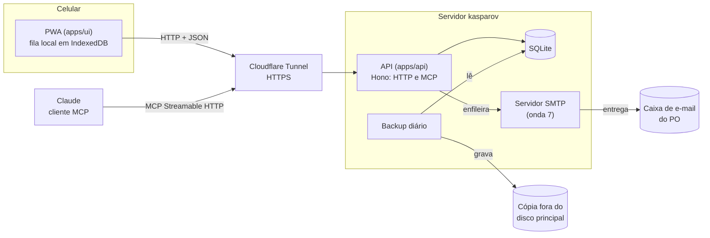

# Arquitetura do Heavy Duty

Este documento descreve os componentes do app, os fluxos principais, os módulos da API e as decisões que ainda estão pendentes. As decisões tomadas estão nas ADRs de `docs/adr/`. Os requisitos vêm de `docs/prd.md`.

Estado: arquitetura planejada. Nenhum componente tem código ainda.

## Componentes

| Componente | Responsabilidade | ADR |
|---|---|---|
| PWA (`apps/ui`) | Mostra o treino do dia, registra séries, conta o descanso e guarda a fila local quando não há rede | ADR-003 |
| API (`apps/api`) | Aplica as regras de negócio e grava os dados. Atende a UI por HTTP | ADR-004 |
| Servidor MCP | Expõe as ferramentas de administração ao Claude. Chama os mesmos services da API | ADR-006 (proposta) |
| SQLite | Guarda catálogo, programas e treinos num arquivo do servidor | ADR-005 |
| Backup diário | Copia o banco para fora do disco principal e registra o resultado | [a confirmar: destino e ferramenta] |
| Cloudflare Tunnel | Publica a API com HTTPS sem abrir porta no roteador (NFR04) | — |
| Servidor SMTP | Entrega os avisos por e-mail a partir da onda 7 (F17). Fica no kasparov, para manter a NFR01 | ADR-007 (proposta) |

## Módulos da API

| Módulo | Entidades | Onda | Features |
|---|---|---|---|
| `catalog` | `MuscleGroup`, `Muscle`, `Exercise` | 1 | F01 |
| `system` | estado do backup | 1 | F14 |
| `programs` | `Program`, `ProgramDay`, `PlannedExercise` | 2 | F02 |
| `workouts` | `Workout`, `WorkoutSet` | 3 e 4 | F03, F04, F05, F06 |
| `windows` | `ActivityWindow`, progresso, nível, pontos, medalhas, `Period` | 5 a 7 | F07, F10, F11, F12 |
| `notifications` | Aviso no celular (Web Push) e por e-mail, resumo semanal | 7 | F09, F17 |

Os nomes das entidades estão em `CONTEXT.md`.

## Fluxos principais

### Registro de série no celular

1. A PWA mostra a série com os valores do programa ou do último treino (US-F03-01).
2. O atleta toca em "feito". A PWA gera uma chave de idempotência e grava a série na fila local.
3. A PWA envia a série à API. Se não há rede, a série fica na fila até a conexão voltar (US-F03-03).
4. A API grava a série. Uma segunda requisição com a mesma chave não cria outra série (US-F03-02, toque duplo).
5. A PWA inicia o descanso com o valor de `restSeconds` do programa (US-F05-01).

### Administração pelo Claude

1. O Claude chama uma ferramenta MCP, como `add_exercise` ou `list_workouts`, com a credencial do PO (US-F16-01).
2. O servidor MCP valida a credencial. Sem credencial válida, a chamada é recusada e nenhum dado sai.
3. A ferramenta chama o service do módulo. A regra de negócio é a mesma da rota HTTP.
4. Ferramenta que remove ou edita histórico só age depois de confirmação explícita (US-F06-02).

## Requisitos não funcionais

| NFR | Onde a arquitetura atende | Estado |
|---|---|---|
| NFR01, dados no servidor | SQLite no kasparov, sem serviço de terceiros para dados | ADR-005 |
| NFR02, autenticação forte | Autenticação na API e no MCP | Pendente |
| NFR03, backup diário | Job de backup com registro do resultado no módulo `system` | Pendente |
| NFR04, HTTPS | Cloudflare Tunnel | Definido no PRD (D02) |
| NFR05, instalação | Manifesto e service worker da PWA | ADR-003 |
| NFR06, sem sinal | Fila local em IndexedDB com envio posterior | Pendente (H10) |

## Decisões pendentes

| Decisão | Insumo | Prazo |
|---|---|---|
| Método de autenticação da PWA e do MCP | NFR02, R07, H12 | Antes da onda 1 (PWA) e da onda 2 (MCP) |
| Biblioteca de acesso ao SQLite e ferramenta de migração | ADR-005 | Scaffold da onda 1 |
| Destino e ferramenta do backup | NFR03, US-F14-02 | Onda 1 |
| Estratégia de sincronização sem sinal | H10, Q09 | Antes da onda 3 |
| Geração do ID no cliente (UUID v7 ou outro) | Fila local, idempotência | Antes da onda 3 |
| Avisos por Web Push | Q02, R01 | Antes da onda 7 |
| Validação da entrega do SMTP próprio (porta 25, SPF, DKIM, DMARC, DNS reverso) | ADR-007, R09 | Antes da onda 7 |
| Lugar das telas de administração: a mesma PWA (`apps/ui`) ou um app separado | D22, Q10, `DESIGN.md` Seção 5.5 | Antes da onda das telas de administração |
| Ferramentas de lint e formatação | `docs/convencoes/codigo.md` | Scaffold da onda 1 |

Cada decisão vira uma ADR quando for tomada.
