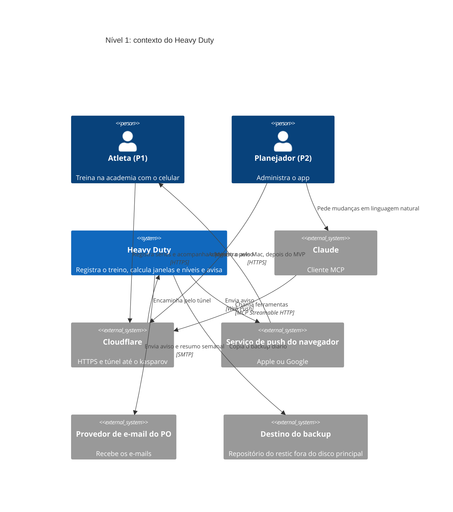
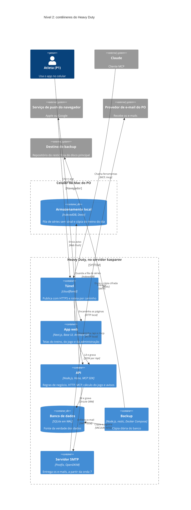

# Arquitetura do Heavy Duty

Esta pasta descreve a arquitetura do Heavy Duty pelo modelo C4, até o nível 2: o contexto do sistema e os contêineres. Cada contêiner tem um arquivo próprio, com responsabilidade, tecnologias, interfaces e regras. O modelo de dados está em `dados.md`. As decisões tomadas estão nas ADRs de `docs/adr/`, e os requisitos vêm de `docs/prd.md`.

Estado: o scaffold (EN-S0) criou o app web, a API, o banco e a configuração do túnel e do Compose, sem regra de domínio. Os outros contêineres ainda não têm código. Tecnologia marcada como Proposta ainda não tem ADR aceita.

## Modelo C4 nesta pasta

| Nível | O que mostra | Onde está |
|---|---|---|
| 1. Contexto | O sistema, as pessoas que o usam e os sistemas externos | Seção "Nível 1" desta página |
| 2. Contêineres | As partes que rodam separadas: apps, bancos, processos | Seção "Nível 2" desta página e um arquivo por contêiner |
| 3. Componentes | Os módulos dentro de cada contêiner | Resumidos no arquivo do contêiner; o detalhe fica no código |

Os diagramas usam a sintaxe C4 do mermaid: `C4Context` no nível 1 e `C4Container` no nível 2. O modelo de dados usa `erDiagram`. A sintaxe C4 do mermaid é marcada como experimental pelo projeto, e o layout automático pode mudar entre versões [a confirmar: renderização no GitHub].

## Nível 1: contexto do sistema

### Pessoas

| Pessoa | Papel | Canal |
|---|---|---|
| Atleta (P1) | O PO na academia, com o celular | App web instalado (PWA) |
| Planejador (P2) | O PO administrando exercícios, programas e histórico | Claude, via MCP; telas de administração no Mac depois do MVP (D22) |

### Sistemas externos

| Sistema | O que faz para o Heavy Duty | Dado que recebe | Requisito |
|---|---|---|---|
| Claude | Cliente MCP que administra o app em nome do Planejador | Chamadas e respostas das ferramentas MCP | F16, ADR-006 |
| Cloudflare | HTTPS e túnel até o kasparov, sem porta aberta no roteador | Tráfego cifrado em trânsito | NFR04, D02 |
| Serviço de push do navegador | Entrega o aviso no celular (Web Push) | Aviso cifrado de ponta a ponta pelo protocolo Web Push | F09, R01, Q02 |
| Provedor de e-mail do PO | Recebe os e-mails de aviso e o resumo semanal | Conteúdo mínimo: grupos, letra, horário e níveis | F17, ADR-007 |
| Destino do backup | Guarda a cópia diária fora do disco principal | Cópia do banco cifrada pelo restic (ADR-018). O destino físico ainda não está escolhido | NFR03, US-F14-02 |

## Nível 2: contêineres

| Contêiner | Responsabilidade | Tecnologia principal | Arquivo |
|---|---|---|---|
| App web | Telas do treino, do jogo e da administração; instalação como PWA | Next.js, React, Base UI, Animate UI, Tailwind CSS (Aceita, ADR-009) | `app-web.md` |
| Armazenamento local | Fila de séries sem sinal e cópia do treino do dia, no navegador | IndexedDB com Dexie | `armazenamento-local.md` |
| API | Regras de negócio, rotas HTTP, servidor MCP, cálculo do jogo e avisos | Node.js 24, Hono, MCP TypeScript SDK | `api.md` |
| Banco de dados | Catálogo, programas, treinos, retratos e registros do sistema | SQLite em WAL, com Drizzle ORM | `banco-de-dados.md` |
| Backup | Cópia diária do banco para fora do disco principal | Agendador Node.js com restic, no serviço `backup` do Compose (Aceita, ADR-018) | `backup.md` |
| Servidor SMTP | Entrega os e-mails de aviso e o resumo semanal, a partir da onda 7 | Postfix e OpenDKIM (Aceita, ADR-007) | `servidor-smtp.md` |
| Túnel | Publica o app com HTTPS e roteia `/api` e `/mcp` para a API | cloudflared | `tunel.md` |

## Ambiente de desenvolvimento

O ambiente de desenvolvimento sobe com `docker compose up`, a partir do `compose.yaml` da raiz (ADR-011). Ele tem três serviços: `web` (Next.js com recarga automática, porta 3000), `api` (Hono com recarga automática, MCP e Swagger em `/api/docs`, porta 3001) e `proxy` (Caddy, ADR-015), que roteia `/api` e `/mcp` para a API e o resto para o app web, como o túnel faz em produção. Só o proxy publica porta no host, em `127.0.0.1:8080`, trocável por `PROXY_PORT`. O banco de desenvolvimento fica em `./data/`, fora do Git. O serviço `backup` fica no profile `backup` e sobe com `docker compose --profile backup up -d backup`, com o repositório do restic no volume `backup-dev-repo` (ADR-018). A configuração das imagens, do Caddy e do túnel fica em `infra/`.

## Implantação no kasparov

- O app web, a API, o servidor SMTP, o túnel e o agendador do backup são processos de longa duração no kasparov. O backup executa uma vez por dia, às 03:00 do fuso configurado.
- O túnel roteia por caminho no mesmo domínio: `/api/*` e `/mcp` vão para a API, e o resto vai para o app web. Com um domínio só, o cookie de sessão é do próprio site, e o navegador não precisa de CORS.
- A configuração sensível vem de variáveis de ambiente, fora do Git (`docs/convencoes/codigo.md`, Seção 11).
- O app web, a API, o túnel e o backup rodam com Docker Compose: `compose.yaml` com `compose.prod.yaml`, que acrescenta o `cloudflared` (ADR-015) e liga o serviço `backup` (ADR-018). O servidor SMTP ainda não tem empacotamento decidido.

## Fluxos entre contêineres

### Registro de série no celular

1. O app web mostra a série com os valores do programa ou do último treino (US-F03-01).
2. O atleta toca em "Próximo". O app web gera o ID da série, que também é a chave de idempotência, e grava a série na fila do armazenamento local.
3. A fila do app web envia a série à API, em ordem. Se não há rede, a série fica na fila e segue quando a conexão volta, sem toque do atleta (US-F03-03, ADR-021).
4. A API grava a série no banco. Uma segunda requisição com o mesmo ID não cria outra série (US-F03-02).
5. O app web inicia o descanso com o `restSeconds` do programa (US-F05-01) e, com a gamificação, mostra os pontos calculados pela API (ADR-010).

### Administração pelo Claude

1. O Claude chama uma ferramenta MCP, como `add_exercise` ou `list_workouts`, com a credencial do PO (US-F16-01).
2. O túnel encaminha `/mcp` para a API, que valida a credencial. Sem credencial válida, a chamada é recusada e nenhum dado sai.
3. A ferramenta chama o service do módulo. A regra de negócio é a mesma da rota HTTP.
4. Ferramenta que remove ou edita histórico só age depois de confirmação explícita (US-F06-02).

### Aviso de janela, a partir da onda 7

1. O agendador da API calcula, a partir do histórico, quando cada janela abre e fecha (ADR-010).
2. Na hora do aviso, a API monta um aviso por letra (D31) e manda pelos dois canais (D32): Web Push para o serviço de push e e-mail para o servidor SMTP.
3. A falha de um canal não bloqueia o outro e fica registrada no banco (`notifications`).

## Requisitos não funcionais

| NFR | Onde a arquitetura atende | Estado |
|---|---|---|
| NFR01, dados no servidor | Banco e servidor SMTP no kasparov; nenhum terceiro guarda dados de treino | ADR-005, ADR-007 |
| NFR02, autenticação forte | Chave de acesso (WebAuthn) e sessão de acesso em cookie no app web e nas rotas `/api/*`; o MCP fica para a US-F16-01 | Parcial: app web e API feitos (ADR-019); MCP pendente (US-F16-01) |
| NFR03, backup diário | Contêiner de backup com restic, com o resultado registrado em `backup_runs` | ADR-018. Pendente: destino físico |
| NFR04, HTTPS | Túnel da Cloudflare | Definido no PRD (D02) |
| NFR05, instalação | Manifesto e service worker do app web (Serwist) | ADR-009 |
| NFR06, sem sinal | Fila no armazenamento local, com envio posterior em ordem, e cópia local do treino do dia | ADR-021 |

## Decisões pendentes

| Decisão | Insumo | Prazo |
|---|---|---|
| Método de autenticação do MCP (o do app web está na ADR-019) | NFR02, R07, H12 | Antes da onda 2 (US-F16-01) |
| Licença "MIT + Commons Clause" do Animate UI: aceitar ou substituir a parte do Animate UI na ADR-009 | ADR-016 | Onda 1, decisão do PO |
| Destino físico do backup e política de retenção | NFR03, ADR-018, `backup.md` | Onda 1, tarefa manual do PO |
| Avisos por Web Push no iPhone | Q02, R01 | Antes da onda 7 |
| Validação da entrega do SMTP próprio | ADR-007, R09 | Antes da onda 7 |
| Lugar das telas de administração: proposta de rotas `/admin` no mesmo app web | D22, Q10, `app-web.md` | Antes da onda das telas de administração |

Cada decisão vira uma ADR quando for tomada.

## Documentos desta pasta

| Arquivo | Conteúdo |
|---|---|
| `app-web.md` | Contêiner do app web (Next.js) |
| `armazenamento-local.md` | Contêiner do armazenamento local (IndexedDB) |
| `api.md` | Contêiner da API (Hono e MCP) |
| `banco-de-dados.md` | Contêiner do banco de dados (SQLite) |
| `backup.md` | Contêiner do backup |
| `servidor-smtp.md` | Contêiner do servidor SMTP |
| `tunel.md` | Contêiner do túnel (cloudflared) |
| `dados.md` | Modelo de entidade e relacionamento |
| `contratos.md` | Contrato de cada rota HTTP, em português |
| `mcp.md` | Ferramentas do servidor MCP |
| `openapi.json` | Documento OpenAPI 3.1 gerado dos schemas (`pnpm --filter @heavy-duty/api openapi`) |
