# Modelo de entidade e relacionamento

Este documento descreve as tabelas do banco de dados (`banco-de-dados.md`), as relações entre elas e as regras que o banco garante. Os nomes de domínio estão em `CONTEXT.md`. O modelo segue a ADR-010: o estado do jogo é calculado a partir do histórico, e só fica guardado o que não pode mudar quando a fórmula muda.

Estado: modelo planejado. As tabelas nascem por migração, na onda da feature que as usa.

Toda medida é inteira, na menor unidade, para evitar ponto flutuante: carga em gramas (`load_g`; 42,5 kg é `42500`, e o passo de 2,5 kg é `2500`) e tempo em segundos. Nenhuma coluna usa `REAL`.

## Diagrama

```mermaid
erDiagram
  MUSCLE_GROUPS ||--o{ MUSCLES : agrupa
  EXERCISES ||--|{ EXERCISE_MUSCLES : ativa
  MUSCLES ||--o{ EXERCISE_MUSCLES : "é ativado em"
  PROGRAMS ||--o{ PROGRAM_DAYS : "divide em"
  PROGRAM_DAYS ||--o{ PLANNED_EXERCISES : lista
  EXERCISES ||--o{ PLANNED_EXERCISES : "é planejado em"
  PROGRAMS ||--o{ WORKOUTS : "é treinado em"
  PROGRAM_DAYS |o--o{ WORKOUTS : "é treinada em"
  WORKOUTS ||--o{ WORKOUT_SETS : registra
  EXERCISES ||--o{ WORKOUT_SETS : "é executado em"
  PLANNED_EXERCISES |o--o{ WORKOUT_SETS : origina
  WORKOUTS ||--o{ WORKOUT_SKIPS : pula
  EXERCISES ||--o{ WORKOUT_SKIPS : "é pulado em"
  PLANNED_EXERCISES |o--o{ WORKOUT_SKIPS : origina
  PERIODS ||--o{ PERIOD_SNAPSHOTS : congela
  MUSCLE_GROUPS ||--o{ PERIOD_SNAPSHOTS : "é retratado em"
  WORKOUTS |o--o{ MEDAL_AWARDS : rende
  PROGRAM_DAYS |o--o{ NOTIFICATIONS : "é avisada em"
  MUSCLE_GROUPS |o--o{ NOTIFICATIONS : "é avisado em"
  OAUTH_CLIENTS ||--o{ OAUTH_AUTHORIZATION_CODES : recebe
  OAUTH_CLIENTS ||--o{ OAUTH_GRANTS : "é autorizado em"

  MUSCLE_GROUPS {
    text id PK
    text slug UK
    text name
    integer position
  }
  MUSCLES {
    text id PK
    text muscle_group_id FK
    text slug UK
    text name
  }
  EXERCISES {
    text id PK
    text slug UK
    text name
    text kind "reps ou time"
    text archived_at "nulo se ativo"
  }
  EXERCISE_MUSCLES {
    text exercise_id PK,FK
    text muscle_id PK,FK
    text role "primary ou secondary"
  }
  PROGRAMS {
    text id PK
    text name
    text goal "strength, hypertrophy ou endurance"
    integer is_active
    text created_at
  }
  PROGRAM_DAYS {
    text id PK
    text program_id FK
    text letter "uma letra de A a Z"
    text label "nome livre da divisão"
    integer position
  }
  PLANNED_EXERCISES {
    text id PK
    text program_day_id FK
    text exercise_id FK
    integer position
    integer sets
    integer target_reps "nulo se time"
    integer target_seconds "nulo se reps"
    integer load_g
    integer rest_seconds
  }
  WORKOUTS {
    text id PK
    text program_id FK
    text program_day_id FK "nulo se a letra saiu do programa"
    text letter "letra treinada, guardada no treino"
    text started_at
    text finished_at
    text end_reason "completed ou ended_early"
  }
  WORKOUT_SETS {
    text id PK "gerado no cliente, chave de idempotência"
    text workout_id FK
    text exercise_id FK
    text planned_exercise_id FK "nulo se o plano mudou"
    integer set_number
    integer load_g
    integer reps "nulo se time"
    integer seconds "nulo se reps"
    text performed_at
    text corrected_at
    integer planned_load_g "plano da série, nulo sem plano"
    integer target_reps "plano da série, nulo se time"
    integer target_seconds "plano da série, nulo se reps"
    text planned_group_sets "JSON: séries planejadas de cada grupo principal na letra"
  }
  WORKOUT_SKIPS {
    text workout_id PK,FK
    text exercise_id PK,FK
    text planned_exercise_id FK "nulo se o plano mudou"
    text skipped_at
  }
  PERIODS {
    text id PK
    integer number UK
    text starts_at
    text ends_at
    text intention "até 120 caracteres, opcional"
    text frozen_at "nulo até o retrato"
  }
  WEEKLY_GOALS {
    integer windows "1 a 77"
    text defined_at
    text id PK
  }
  PERIOD_SNAPSHOTS {
    text id PK
    text period_id FK "UK com muscle_group_id"
    text muscle_group_id FK
    integer level
    integer points
    integer best_level
    text window_state
    integer windows_used
    integer windows_missed
  }
  MEDAL_AWARDS {
    text id PK
    text medal_code UK
    text subject "grupo da medalha de nível, opcional"
    text workout_id FK "nulo sem treino ou com o treino removido"
    text awarded_at
  }
  PUSH_SUBSCRIPTIONS {
    text id PK
    text endpoint UK
    text p256dh
    text auth
    text created_at
    text updated_at
  }
  NOTIFICATIONS {
    text id PK
    text notice_key "UK com channel"
    text kind "window_open, window_close, level_drop ou weekly_digest"
    text channel "push ou email"
    text letter
    text muscle_group_slugs "JSON, nulo no resumo semanal"
    text due_at
    text event_at
    text created_at
    text status "sent, failed, skipped ou nulo"
    text error
    text finished_at
    text unsubscribe_token_hash UK "só no canal email, US-F17-04"
  }
  SETTINGS {
    text key PK
    text value
  }
  AUTH_CREDENTIALS {
    text id PK
    text credential_id UK
    blob public_key
    integer counter
    text transports "JSON, nulo"
    text created_at
    text last_used_at
  }
  AUTH_SESSIONS {
    text id PK
    text token_hash UK
    text created_at
    text expires_at
    text last_seen_at
  }
  ENROLLMENT_TOKENS {
    text id PK
    text token_hash UK
    text created_at
    text expires_at
    text used_at
  }
  OAUTH_CLIENTS {
    text id PK "client_id"
    text client_name
    text redirect_uris "JSON"
    text created_at
    text approved_at
  }
  OAUTH_AUTHORIZATION_CODES {
    text id PK
    text code_hash UK
    text client_id FK
    text redirect_uri
    text code_challenge
    text resource
    text created_at
    text expires_at
    text used_at
  }
  OAUTH_GRANTS {
    text id PK
    text client_id FK
    text resource
    text access_token_hash UK
    text access_expires_at
    text refresh_token_hash UK
    text previous_refresh_token_hash
    text refresh_expires_at
    text created_at
    text revoked_at
  }
  BACKUP_RUNS {
    text id PK
    text started_at
    text finished_at
    text status "succeeded ou failed"
    integer size_bytes
    text error
  }
```

## Tabelas

### Catálogo (F01, onda 1)

| Tabela | Conteúdo | Regras |
|---|---|---|
| `muscle_groups` | Os 11 grupos do catálogo inicial (D30) | `slug` único. O grupo com músculo não pode ser removido |
| `muscles` | Músculos, cada um num grupo | `muscle_group_id` obrigatório: músculo sem grupo é recusado com "informe o grupo muscular" (US-F01-01) |
| `exercises` | Exercícios de repetição ou de tempo | `slug` único, derivado do nome com a mesma regra do slug do músculo: exercício repetido é recusado com "exercício já cadastrado" (US-F01-02). `kind` em `reps` ou `time`, com `CHECK`. Exercício usado no histórico é arquivado (`archived_at`), não apagado, e sai da lista de exercícios |
| `exercise_muscles` | Músculos que o exercício ativa, com o papel | Chave composta `exercise_id` e `muscle_id`: o mesmo músculo não entra duas vezes no exercício. `role` em `primary` ou `secondary`, com `CHECK`. Pelo menos um músculo `primary` por exercício: sem ele, o cadastro é recusado com "informe ao menos um músculo" (US-F01-02). O exercício e os músculos são gravados numa transação. `exercise_id` em `ON DELETE CASCADE`; `muscle_id` em `ON DELETE RESTRICT`: o músculo usado num exercício não pode ser removido. O secundário conta metade do volume (D30, Q08) |

### Programa (F02, onda 2)

As três tabelas vêm da migração `0005_programs` (US-F02-01). O programa é montado em passos: um programa sem letra e uma letra sem exercício são estados válidos durante a montagem.

A edição do programa (US-F02-02) muda as linhas sem tocar no treino registrado. A remoção da letra apaga a linha de `program_days`, e os exercícios do programa dela saem por `ON DELETE CASCADE`. A remoção do exercício do programa apaga a linha de `planned_exercises`. Nenhuma remoção renumera `position`: a ordem relativa fica, com lacuna, e a próxima inclusão usa a maior `position` mais 1. Por isso a letra removida e acrescentada de novo volta vazia, no fim da ordem. Escolher o programa ativo desativa o anterior e ativa o escolhido na mesma transação, nessa ordem, por causa do índice parcial. O programa não tem remoção.

| Tabela | Conteúdo | Regras |
|---|---|---|
| `programs` | Programas, com objetivo | `goal` é `strength`, `hypertrophy` ou `endurance`, com `CHECK`. O objetivo define a janela-base (regra 2 da gamificação). Um programa ativo por vez: o índice único parcial `programs_single_active_idx` em `is_active` com `WHERE is_active = 1` garante a regra no banco. A criação desativa o programa ativo anterior e grava o novo como ativo na mesma transação. O nome não é único. A lista vem com o ativo primeiro, depois `created_at` e `id` decrescentes |
| `program_days` | Letras do programa: uma para corpo inteiro, duas para superior e inferior, três para ABC, e assim por diante | `letter` é uma letra de A a Z, em maiúscula, com `CHECK (letter GLOB '[A-Z]')`, até 26 letras. O par `program_id` e `letter` é único. `label` é livre e dá o nome da divisão, como "Superior", "Empurrar" ou "Peito e tríceps"; fica nulo na letra sem nome. `position` define a ordem do plano (ordem de inclusão, a partir de 1), e o par `program_id` e `position` é único. `program_id` usa `ON DELETE CASCADE` |
| `planned_exercises` | Exercícios de cada letra, com séries, alvo, carga e descanso | `CHECK` de `sets >= 1`, `target_reps >= 1`, `target_seconds >= 1`, `load_g >= 0` e `rest_seconds >= 0`, todos inteiros (carga em gramas, tempo e descanso em segundos). Exatamente um entre `target_reps` e `target_seconds`, com `CHECK`; o service escolhe o alvo pelo tipo do exercício. `position` é a ordem da letra (ordem de inclusão, a partir de 1), e o par `program_day_id` e `position` é único. O par `program_day_id` e `exercise_id` é único: o mesmo exercício não entra duas vezes na mesma letra. `program_day_id` usa `ON DELETE CASCADE`. `exercise_id` usa `ON DELETE RESTRICT`, com o índice `planned_exercises_exercise_idx`: o exercício usado num programa não sai do banco |

### Execução (F03 a F06, ondas 3 e 4)

A US-F02-02 antecipou `workouts` e `workout_sets` na migração `0006_workouts`, sem rota nem ferramenta, para o banco garantir que editar o programa não altera treino registrado (FR-009 da US-F02-02; `apps/api/CLAUDE.md`, regra 7). A US-F03-02 passou a gravar as duas tabelas pela rota `POST /api/workouts/{workoutId}/sets` (`contratos.md`) e acrescentou o índice único `workout_sets_workout_exercise_set_unique` na migração `0008_workout_sets_unique`. A cadeia de `SET NULL` (letra, exercício do programa, série) depende de `foreign_keys = ON`, que `openDatabase` liga.

Regras da gravação (US-F03-02):

- **Treino nasce com a primeira série.** O celular gera o `id` do treino (UUID v7) e `started_at` no toque em "Começar", e o envio de cada série leva o programa, a letra e o início. A primeira série grava o treino; as seguintes entram no mesmo treino. O mesmo `id` de treino com outro programa, outra letra ou outro início é recusado com 409.
- **Idempotência pelo `id` da série.** O `id` da série vem do celular (UUID v7) e é a chave primária. O reenvio com o mesmo `id` e os mesmos valores (`workout_id`, `exercise_id`, `set_number`, `load_g`, `reps` e `seconds`) não grava nada e devolve a série gravada; com valores diferentes, é recusado com 409.
- **Datas do cliente.** `started_at` e `performed_at` vêm do celular, em ISO 8601 em UTC, normalizadas com `toISOString()`. A API não corrige o relógio do celular, porque na US-F03-03 a série pode chegar ao servidor muito depois do toque.
- **Plano da série (ADR-033).** A série guarda o plano do momento do registro em `planned_load_g`, `target_reps` e `target_seconds`, lidos do exercício do programa pela API na gravação. A correção não muda o plano da série. A migração `0010_workout_sets_plan` (US-F10-01) cria as colunas, preenche as séries antigas com o plano atual do exercício do programa e deixa nulas as séries sem exercício do programa. Como o SQLite não acrescenta `CHECK` de tabela a uma tabela existente, a migração recria `workout_sets` e copia as linhas. O adendo da ADR-033 (US-F10-02) acrescenta `planned_group_sets`: um objeto JSON com as séries planejadas, na letra, de cada grupo principal do exercício da série (`{ "chest": 6 }`), contadas pela API no registro, a base do ganho do grupo (D54). A migração `0011_workout_sets_group_plan` cria a coluna e preenche as séries antigas pela letra atual do treino; a série de treino sem letra (`program_day_id` nulo) fica nula, e o recálculo conta as séries registradas do grupo naquele treino.
- **Uma série por treino, exercício e número.** O índice único `workout_sets_workout_exercise_set_unique` em `(workout_id, exercise_id, set_number)` recusa uma segunda série com outro `id` para o mesmo exercício e o mesmo número no treino; o service confere antes e responde 409 `workout_set_duplicated`. O índice usa `exercise_id`, e não `planned_exercise_id`, porque o vínculo com o plano fica nulo quando o plano muda, e o SQLite não compara nulos no índice único. Como `planned_exercises_day_exercise_unique` garante um exercício por letra, o exercício equivale ao exercício do programa dentro do treino de uma letra.

| Tabela | Conteúdo | Regras |
|---|---|---|
| `workouts` | Treinos realizados de uma letra | Guarda `program_id` (`NOT NULL`, `ON DELETE RESTRICT`) e a letra treinada em `letter` (`CHECK (letter GLOB '[A-Z]')`). `program_day_id` é nulo e usa `ON DELETE SET NULL`: quando a letra sai do programa, o treino continua com a letra e as séries, sem o vínculo. `started_at` é obrigatório. `finished_at` e `end_reason` são nulos no treino em andamento e a rota `POST /api/workouts/{workoutId}/finish` grava os dois (US-F03-04); `end_reason` registra se o treino terminou na última série ou foi encerrado antes (D25), com `CHECK` em `completed` ou `ended_early`. A ferramenta `remove_workout` apaga a linha e, por `ON DELETE CASCADE`, as séries e os pulos (US-F06-02, ADR-026). Índices `workouts_program_idx` e `workouts_program_day_idx` |
| `workout_sets` | Séries registradas | `id` gerado no cliente: o mesmo `id` não cria outra série (US-F03-02). A correção da última série (US-F04-02) troca só `load_g` e `reps` ou `seconds` da linha e grava `corrected_at` com o instante da chegada na API quando a carga ou a medida muda (US-F06-01); `id`, `workout_id`, `exercise_id`, `planned_exercise_id`, `set_number` e `performed_at` não mudam, e o treino terminado aceita a troca (`PATCH /api/workouts/{workoutId}/sets/{setId}`, `contratos.md`). A ferramenta `update_workout_set` do planejador troca os mesmos campos e segue a mesma regra de `corrected_at` (US-F06-02). O trio `workout_id`, `exercise_id` e `set_number` é único (`workout_sets_workout_exercise_set_unique`). `CHECK` de `set_number >= 1`, `load_g >= 0` (em gramas inteiras), `reps >= 1` e `seconds >= 1`, e exatamente um entre `reps` e `seconds`. Guarda `exercise_id` e os valores executados, para o histórico não mudar quando o programa muda (US-F02-02). Guarda também o plano da série (ADR-033): `planned_load_g` (gramas, `>= 0`), `target_reps` e `target_seconds` (`>= 1`), gravados no registro; o `CHECK` `workout_sets_plan_check` aceita as três colunas nulas (série sem plano) ou `planned_load_g` com exatamente um entre `target_reps` e `target_seconds`. `planned_group_sets` guarda, em JSON, as séries planejadas de cada grupo principal do exercício na letra, no registro, e fica nulo no treino sem letra. `workout_id` usa `ON DELETE CASCADE`; `exercise_id` usa `ON DELETE RESTRICT`; `planned_exercise_id` é nulo e usa `ON DELETE SET NULL` ("nulo se o plano mudou"). Um índice por FK |
| `workout_skips` | Exercícios pulados num treino (US-F03-05) | Um registro por exercício que ficou de fora do treino, com o instante do último pulo em `skipped_at`. A chave primária é `(workout_id, exercise_id)`: o exercício é único na letra e o vínculo com o plano fica nulo quando o plano muda, então a chave usa `exercise_id`. `workout_id` usa `ON DELETE CASCADE`; `exercise_id` é obrigatório e usa `ON DELETE RESTRICT`; `planned_exercise_id` é nulo e usa `ON DELETE SET NULL`, como em `workout_sets`, para o registro ficar quando o planejador remove o exercício da letra (FR-022). Índices `workout_skips_exercise_idx` e `workout_skips_planned_exercise_idx`. A rota `POST /api/workouts/{workoutId}/skips` grava a linha (`contratos.md`). Alimenta o resumo "Ficaram de fora" |

### Gamificação (ondas 5 a 7)

| Tabela | Conteúdo | Regras |
|---|---|---|
| `periods` | Períodos de 12 semanas, com a frase de intenção (US-F11-01, ADR-039) | Um período aberto por vez. `number` é único, a partir de 1. Só o início do período 1 é fato guardado: a API grava a linha do período 1 na primeira partida com a tabela vazia, com `starts_at` na segunda-feira 00:00 da semana, no fuso `NOTICE_TIME_ZONE`, em UTC, e `ends_at` 84 dias depois (D95, D96). A linha do período *n* nasce na primeira leitura ou no agendador do jogo, com `starts_at` = início do período 1 + (*n* − 1) × 84 dias (D94). `intention` é opcional, com até 120 caracteres, e muda até o fim do período (D98). `frozen_at` fica nulo até o retrato |
| `period_snapshots` | Retrato congelado de cada grupo no fim do período (US-F11-02, ADR-039) | Gravado uma vez e nunca alterado, mesmo se a fórmula do jogo mudar ou se um treino do período for editado (ADR-010). Uma linha por grupo muscular, com `period_id` e `muscle_group_id` únicos juntos: nível, pontos da barra, melhor nível, estado da janela e janelas aproveitadas e perdidas no período, no instante do fim do período (D99). O resumo do período (frase, janelas aproveitadas e perdidas, pontos, pontos do melhor treino e sequência de semanas no fim) também fica gravado no congelamento; as colunas finais saem da especificação da US-F11-02 |
| `medal_awards` | Medalhas conquistadas (US-F19-01, ADR-040) | `medal_code` único: a medalha se conquista uma vez. `subject` guarda o grupo muscular da medalha de nível, como o "nível 10 em peito", e fica nulo nas outras. `workout_id` aponta o treino da conquista e usa `ON DELETE SET NULL`: a remoção do treino não tira a medalha. `awarded_at` é o instante do evento, não o da detecção. Nenhuma linha muda nem sai. O catálogo das medalhas fica no código do módulo `medals` (`medals.catalog.ts`, D103) |
| `weekly_goals` | Metas semanais de janelas (US-F15b-02), uma linha por definição | Só inclusão: a ferramenta `set_weekly_goal` grava uma linha com o relógio da API em `defined_at` (ISO 8601, UTC) e nenhuma linha muda nem sai. `windows` é inteiro com `CHECK` de 1 a 77 (11 grupos × 7 dias). A meta de uma semana é a da linha mais recente com `defined_at` anterior ao fim da semana (D75); sem linha, a semana não tem meta (D76). Índice `weekly_goals_defined_at_idx`. Migração `0012_weekly_goals` |

### Avisos (F09 e F17, onda 7)

| Tabela | Conteúdo | Regras |
|---|---|---|
| `push_subscriptions` | Inscrições de Web Push do navegador (migração `0013_push_subscriptions`, US-F09-01, ADR-035) | `endpoint` único, só `https`, com até 2048 caracteres. `p256dh` e `auth` em base64url, até 256 caracteres. `created_at` e `updated_at` em UTC; o reenvio do mesmo `endpoint` a cada abertura do app troca as chaves e `updated_at`. Desligar os avisos apaga a linha. Inscrição recusada pelo serviço de push com 404 ou 410 é apagada |
| `notifications` | Registro de cada aviso, por canal | Um aviso de janela por letra (D31), nos dois canais (D32). A falha de um canal não muda o outro. Cada aviso sai no máximo uma vez por canal, por uma chave única (ADR-036). A linha do e-mail guarda em `unsubscribe_token_hash` o SHA-256 do token do link de desligar daquele e-mail; o token em claro só existe no e-mail (D89, ADR-037). Migração `0014_notifications` (US-F09-02): `notice_key` identifica o aviso pelo tipo, pela letra ou pelo grupo e pelo instante do evento; no aviso de queda, o instante é o fechamento da janela que iniciou o esfriamento, para sair um aviso só por esfriamento (D84). `notice_key` e `channel` são únicos juntos. `kind` é `window_open`, `window_close` ou `level_drop`, e `channel`, `push` ou `email`, com `CHECK`. `letter` é a letra do aviso (na queda, a de `letterForGroupOf`); `muscle_group_slugs`, os grupos em JSON. `due_at` é o horário do aviso, já com o silêncio (D80), e `event_at`, o da abertura, do fechamento ou da queda. O agendador grava a linha antes do envio (`created_at`) e o resultado depois: `status` `sent`, `failed` ou `skipped` (canal sem destinatário), `error` com o motivo seguro, até 500 caracteres, e `finished_at`. A linha sem `status` é um envio que o processo não terminou, e o aviso se perde (ADR-036). Índice em `channel` e `created_at`, para a situação dos avisos (US-F17-01). A coluna `unsubscribe_token_hash` sai da US-F17-04. Na onda 7b (US-F17-03, ADR-041), uma migração recria a tabela, porque o SQLite não altera `CHECK`, e preserva as linhas: `kind` passa a aceitar `weekly_digest`, só no canal `email`, com `notice_key` `weekly_digest:<início da semana>`, e `muscle_group_slugs` fica nulo no resumo semanal |

### Sistema (F14, onda 1)

| Tabela | Conteúdo | Regras |
|---|---|---|
| `settings` | Configurações em chave e valor, como `email_enabled` e `webauthn_user_id` | Sem segredo em texto puro. `email_enabled = false` desliga só os e-mails, pelo link de desligar ou pela ferramenta `set_email_notices` (D90, D91); o hash do token de desligar fica em `notifications`, um por e-mail (D89). O endereço de e-mail do PO e as credenciais ficam em variável de ambiente. `webauthn_user_id` é o identificador estável do usuário nas cerimônias da chave de acesso (16 bytes aleatórios em base64url), criado no primeiro cadastro e nunca trocado (US-F14-01) |
| `backup_runs` | Uma linha por execução do backup, com início, fim, situação, tamanho e motivo | Gravada uma vez, no fim da execução, também na falha (F14). `status` é `succeeded` ou `failed`, com `CHECK`. `size_bytes` é o tamanho em bytes da cópia, inteiro não negativo com `CHECK`, e fica nulo na falha. `error` traz o motivo seguro da falha, com até 500 caracteres, e fica nulo no sucesso. Sem índice: a tabela cresce cerca de 365 linhas por ano [estimativa: uma execução por dia]. Só o processo do backup grava a tabela; a API e o MCP só leem (`get_system_status`) |

### Acesso (F14, onda 1, e F16, onda 2)

As três primeiras tabelas vêm da migração `0004_auth_passkeys` (US-F14-01, ADR-019); as três do MCP, da migração `0007_auth_oauth` (US-F16-01, ADR-020). Não há tabela de usuário: o PO é o único usuário (D07), e toda chave de acesso cadastrada é dele. As datas ficam em ISO 8601, em UTC.

| Tabela | Conteúdo | Regras |
|---|---|---|
| `auth_credentials` | Chaves de acesso (`AuthCredential`) cadastradas | `credential_id` único, em base64url. `public_key` em blob, no formato COSE. `counter` inteiro com `CHECK (counter >= 0)`, atualizado a cada entrada; a biblioteca recusa contador menor que o gravado. `transports` em texto JSON, nulo quando o navegador não informa. `last_used_at` nulo até a primeira entrada. A chave pública não sai em resposta nem em log (FR-028). Sem revogação nesta story |
| `auth_sessions` | Sessões de acesso (`AuthSession`) | `token_hash` único: SHA-256 em hexadecimal do token aleatório de 32 bytes; o token em claro só existe no cookie `hd_session`. `expires_at` é 30 dias depois de `last_seen_at`. O uso renova `last_seen_at` e `expires_at` no máximo uma vez a cada 24 horas. A saída apaga a linha. A criação de uma sessão apaga as vencidas |
| `enrollment_tokens` | Links de cadastro (`EnrollmentToken`) | `token_hash` único: SHA-256 do token, que só existe na saída do comando `auth:enroll`. `expires_at` é 15 minutos depois de `created_at`. `used_at` fica nulo até o consumo, que é atômico (`UPDATE … WHERE used_at IS NULL AND expires_at > ?`) e acontece na mesma transação que grava a chave de acesso. A criação de um link apaga os vencidos |
| `oauth_clients` | Clientes do MCP (`OAuthClient`) registrados pelo registro dinâmico | `id` em UUID v7 é o `client_id`. `client_name` é o nome declarado, não confiável, até 100 caracteres, ou nulo. `redirect_uris` em texto JSON, de 1 a 5 endereços `https` ou de loopback. `approved_at` nulo até a primeira aprovação do PO. No máximo 20 clientes nunca aprovados: o registro apaga os nunca aprovados com mais de 24 horas e, na lotação, o mais antigo deles. Cliente aprovado não sai pelo despejo |
| `oauth_authorization_codes` | Códigos de autorização | `code_hash` único: SHA-256 do código aleatório de 32 bytes, que só existe no redirecionamento ao `redirect_uri`. `client_id` com `ON DELETE CASCADE`. Guarda o `redirect_uri` e o desafio PKCE `S256` do pedido e o recurso `<APP_ORIGIN>/mcp`. `expires_at` é 5 minutos depois de `created_at`. O consumo é atômico (`UPDATE … WHERE used_at IS NULL AND expires_at > ?`). O comando `auth:revoke-mcp` marca `used_at` nos pendentes |
| `oauth_grants` | Autorizações do MCP (`OAuthGrant`), uma linha por aprovação trocada | `client_id` com `ON DELETE CASCADE`. `access_token_hash` e `refresh_token_hash` únicos: SHA-256 da credencial do MCP e do token de renovação atuais, que só existem na resposta do token. `access_expires_at` é 1 hora depois da emissão; `refresh_expires_at`, 30 dias depois da última emissão. A renovação troca os dois hashes na mesma linha e guarda o anterior em `previous_refresh_token_hash`; o reuso do anterior marca `revoked_at`. O comando `auth:revoke-mcp` marca `revoked_at` em todas as ativas. A cada emissão, saem os códigos vencidos e as autorizações com renovação vencida |

O desafio da cerimônia (`AuthChallenge`) não é tabela: fica na memória do processo da API por 5 minutos (ADR-019).

## O que não é tabela

Pela ADR-010, estes dados são calculados pela API a cada leitura, a partir de `workout_sets`, `exercise_muscles`, `programs` e dos parâmetros do jogo. O plano da série entra na conta como fato guardado na série (ADR-033). As regras puras de pontos, nível, perda e recorde e os parâmetros delas ficam no pacote `@heavy-duty/game` (ADR-034):

| Dado calculado | Termo em `CONTEXT.md` |
|---|---|
| Abertura e fechamento da janela de cada grupo | Janela de atividade |
| Volume e volume ajustado por grupo | Volume, Volume ajustado |
| Pontos, progresso, nível, melhor nível e faixa | Pontos, Progresso, Nível, Melhor nível, Faixa |
| Perda de nível e memória muscular | Esfriar, Memória muscular |
| Recorde por exercício | Recorde |
| Limites e semanas de cada período a partir do início do período 1 (ADR-039) | Período |
| Pontos do treino, pontos da semana e posição no ranking (ADR-034, adendo da onda 7b) | Pontos do treino, Ranking pessoal |
| Sequência de semanas e proteção da sequência (D101) | Sequência de semanas, Proteção da sequência |
| Metas O1 e O4 do período e progresso no período de cada grupo (D100) | Período, Janela aproveitada |
| Conteúdo do resumo semanal (ADR-041) | Resumo semanal |
| Janelas aproveitadas, perdidas e abertas de cada semana (a meta semanal fica em `weekly_goals`) | Janela aproveitada |

O nível geral, o grupo que limita e a sugestão da letra pelas janelas também não são tabela, mas o celular é quem os calcula, com as regras do pacote `@heavy-duty/game`, a partir das cópias de `GET /api/today`, das janelas e dos níveis (ADR-034, adendo da onda 6b). A API dá só a letra da rotação da US-F03-01, em `GET /api/today`.

## Pendências do modelo

| Pendência | Efeito no modelo | Insumo |
|---|---|---|
| Versão do UUID | Formato do `id` de todas as tabelas; UUID v7 ordena por tempo | `docs/convencoes/codigo.md`, Seção 7 |
| Estratégia de sincronização sem sinal | Campos de controle em `workout_sets`, se houver conflito a resolver | H10, `armazenamento-local.md` |
| Tempo no volume | Como `seconds` entra no volume e nos pontos | Q07 |
